<div align="center">


# Leaseweb Dock

**A self-hosted control panel for sharing Leaseweb servers with your customers, friends and team.**

Everyone gets their own login to reboot, reinstall, rescue and monitor *their* Leaseweb dedicated servers, VPS and Public Cloud instances. Nobody needs your Leaseweb account.

[](https://github.com/MahdiGraph/LWDock/releases)
[](https://github.com/MahdiGraph/LWDock/actions/workflows/docker.yml)
[](https://github.com/MahdiGraph/LWDock/pkgs/container/lwdock)
[](LICENSE)
[](https://github.com/MahdiGraph/LWDock/stargazers)

[Install](#install) · [Features](#features) · [Screenshots](#screenshots) · [FAQ](#faq) · [Security](#security)

</div>

<br>

<picture>
  <source media="(prefers-color-scheme: dark)" srcset="docs/screenshots/server-dark.png">
  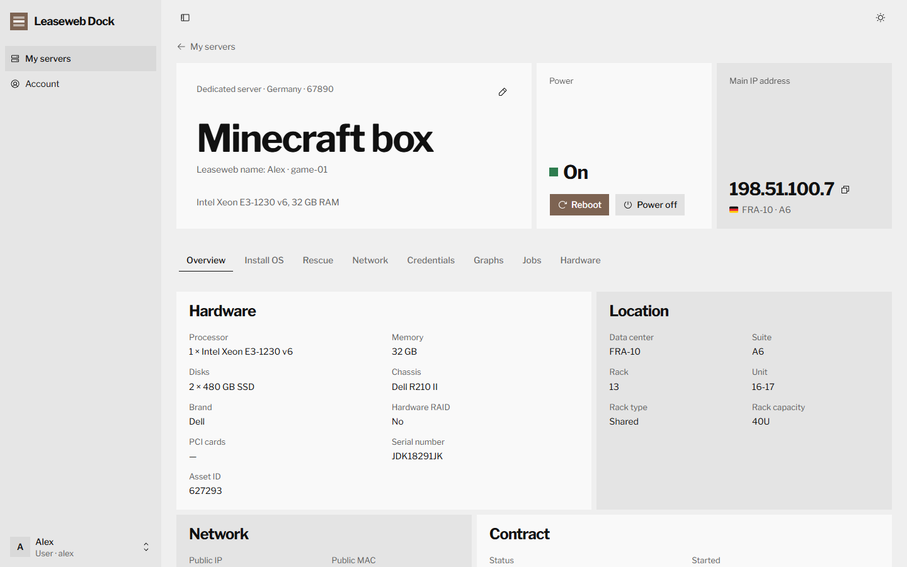
</picture>

## Why it exists

If you buy Leaseweb servers for other people, you know the routine. A server hangs, and the owner messages you to reboot it. Someone wants a fresh Ubuntu, a reverse DNS record or the root password, and every time it waits for you, because they cannot have access to your Leaseweb Customer Portal.

**Leaseweb Dock** is a small web panel you run on any Linux box. You add your Leaseweb API keys once, create a login for each person and assign them their servers. From then on they handle their own servers, and you see everything they do in the activity log.

## Features

### For the people you share servers with

- **Power**: power on, power off and reboot (power cycle), with the live power state.
- **Reinstall**: install any operating system Leaseweb offers, with a control panel, SSH keys, root password and a post-install script. Progress shows live on the *Jobs* tab, where jobs can also be cancelled or retried.
- **Rescue mode**: boot a rescue image to repair a broken system.
- **Network**: reverse DNS, DDoS detection profile, null routing on and off, and opening or closing switch ports.
- **Credentials**: show, copy, add and change the passwords Leaseweb keeps for the server.
- **Graphs**: bandwidth (average or 95th percentile) and data traffic; CPU for Public Cloud.
- **Hardware**: the latest hardware report, a new hardware scan and an IPMI reset.
- **Public Cloud and VPS**: start, stop, reboot, web console (noVNC), reinstall from any image, snapshots and ISO images.
- **Their own names**: each user can rename a server for themselves. Your Leaseweb reference stays as it is.

### For you, the admin

- **Several Leaseweb API keys**: Leaseweb issues one key per regional company (Netherlands, Germany, USA, Asia…). Add them all; servers from every account appear in one list with their **country flags**.
- **Users and assignments**: create users, assign servers with a click, disable or reset accounts.
- **Activity log**: who rebooted, reinstalled or changed what, on which server, and what Leaseweb answered.
- **Outbound proxy**: send every API request through an **HTTP, HTTPS, SOCKS4, SOCKS5 or SOCKS5h** proxy, with no silent direct fallback. Useful when your server's network cannot reach the Leaseweb API.
- **Billing stays private**: users never see prices, customer IDs or servers that are not theirs.
- **Your references stay yours**: the panel never changes server references at Leaseweb, so they keep telling you whose server is whose.
- **Dark and light themes**, and a layout that works on a phone.
- **Easy to run**: one Docker container with a SQLite database, a one-line installer for amd64 and arm64.

## Install

On a Linux server (Ubuntu, Debian, CentOS, Rocky, Alma, Fedora…) with 1 GB RAM or more:

```bash
curl -fsSL https://raw.githubusercontent.com/MahdiGraph/LWDock/main/install.sh | sudo bash
```

The installer:

1. installs Docker and the Docker Compose plugin if they are missing,
2. downloads Leaseweb Dock to `/opt/leaseweb-dock` and generates a secret,
3. asks **where to listen**: on all addresses (open `http://SERVER-IP:PORT` directly) or on `127.0.0.1` only (behind your own reverse proxy),
4. asks **which port**, suggesting a free one,
5. starts the panel and prints its address.

Open that address and create the admin account right away: the first person to open the panel becomes the admin.

**Update** by running the same command again. It keeps your data, and pressing Enter keeps the current address and port. To skip the questions, put the answers in front of `bash`:

```bash
curl -fsSL https://raw.githubusercontent.com/MahdiGraph/LWDock/main/install.sh | sudo LISTEN_ADDRESS=127.0.0.1 PORT=8080 bash
```

<details>
<summary><b>Docker Compose by hand</b></summary>

```bash
git clone https://github.com/MahdiGraph/LWDock.git leaseweb-dock
cd leaseweb-dock
echo "APP_SECRET=$(openssl rand -hex 32)" > .env
docker compose up -d
```

`docker compose up` uses the published image `ghcr.io/mahdigraph/lwdock`. If it cannot be pulled, build it locally with `docker compose up -d --build`. Leaseweb Dock needs Docker Compose v2, the `docker compose` command (with a space); the old `docker-compose` 1.x is not supported.

</details>

<details>
<summary><b>From source, without Docker (Node.js 20.9 or newer)</b></summary>

```bash
git clone https://github.com/MahdiGraph/LWDock.git
cd LWDock
npm ci
npm run build
npm start
```

The panel listens on port 3000 and keeps its data in `./data`. Change that with a `.env` file (see [`.env.example`](.env.example)).

</details>

## First steps

1. **Settings → Leaseweb accounts**: add one API key per Leaseweb company you buy from, for example *Netherlands* and *Germany*, and press **Test**. Create keys in the Leaseweb Customer Portal under [API keys](https://secure.leaseweb.com/api-client-management/).
2. **Settings → Outbound proxy** (optional): turn it on if the panel must reach Leaseweb through a proxy.
3. **Users**: create a login for each person and send them the generated password.
4. **Servers**: press **Assign** next to a server and tick the people who should manage it.

They sign in at the same address and see only their own servers.

## Screenshots

| | |
| :-: | :-: |
| 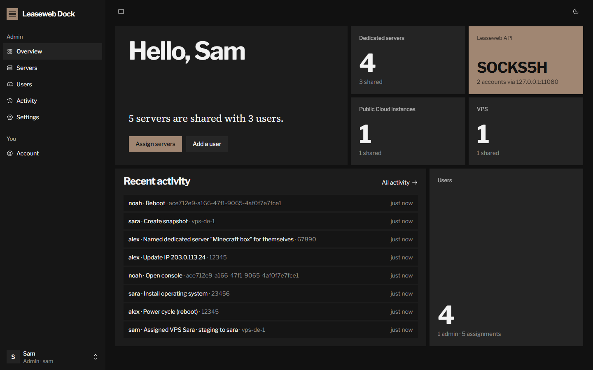 | 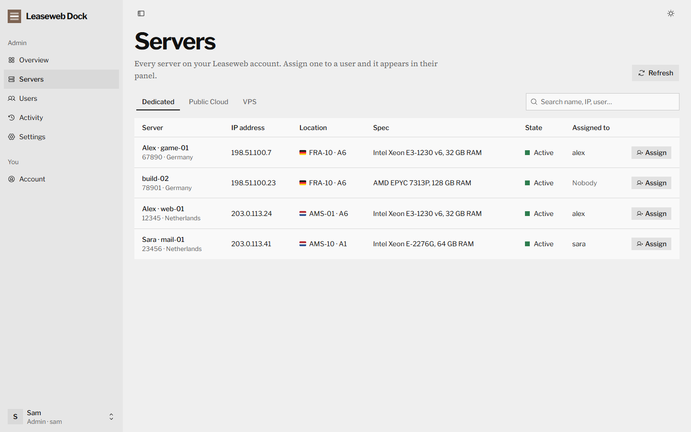 |
| **Overview**: counts, connection and recent activity | **Servers** from every account, with flags |
| 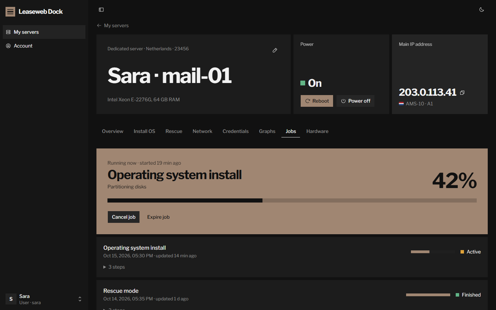 | 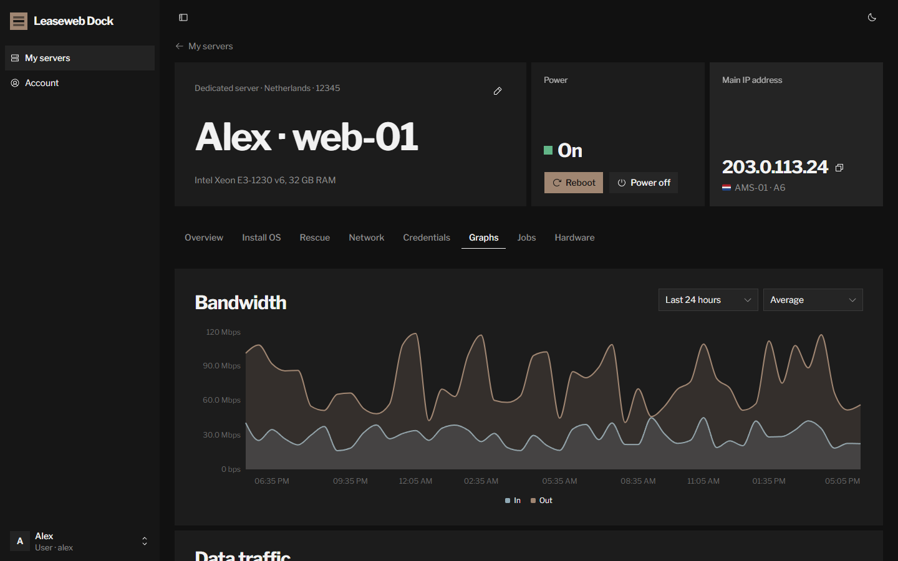 |
| **Jobs**: a reinstall in progress | **Graphs**: bandwidth and data traffic |
| 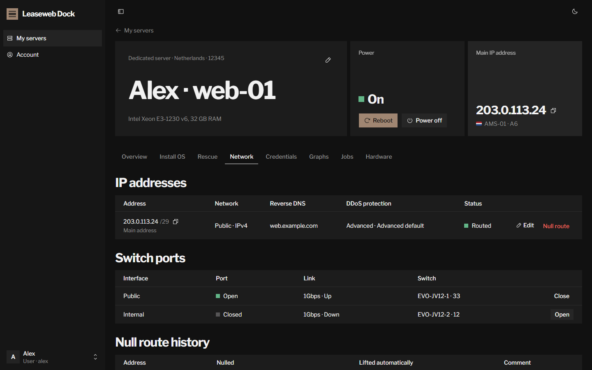 | 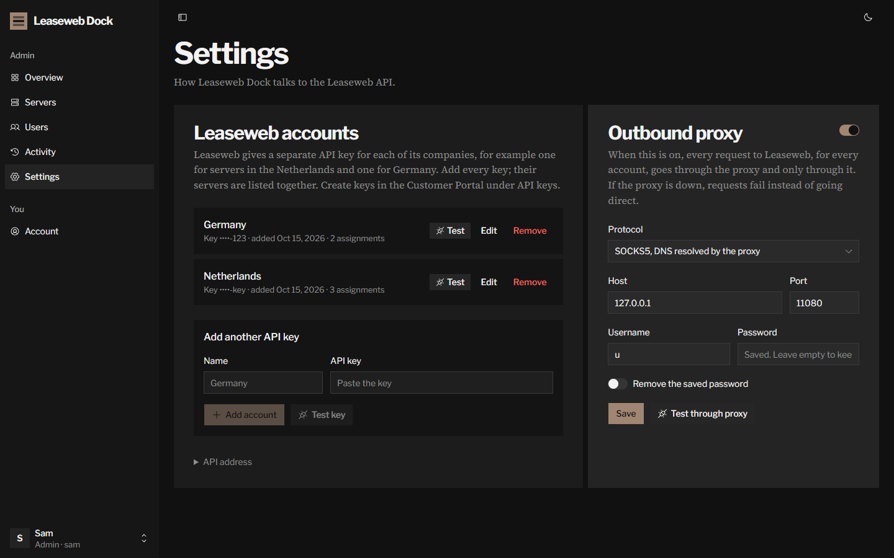 |
| **Network**: reverse DNS, null routes, switch ports | **Settings**: API keys and outbound proxy |

<details>
<summary><b>More screenshots</b></summary>
<br>

| | |
| :-: | :-: |
| 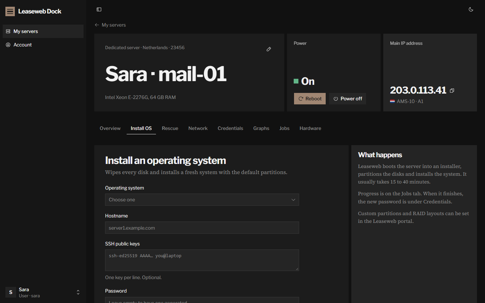 | 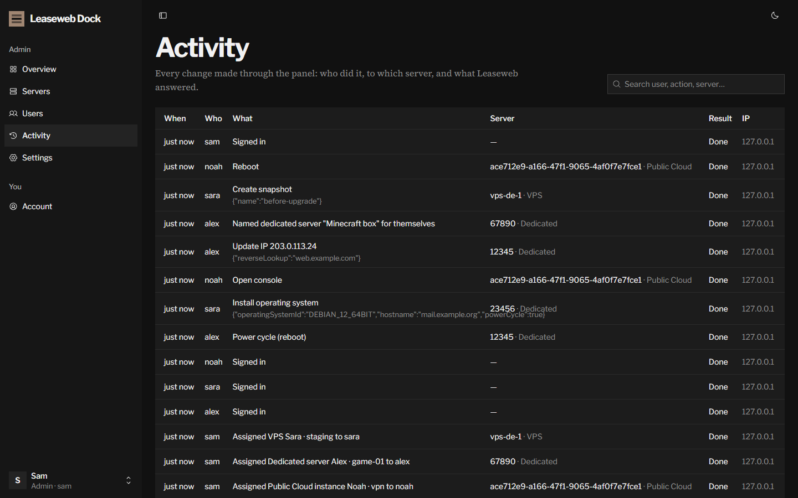 |
| **Install OS** | **Activity log** |
| 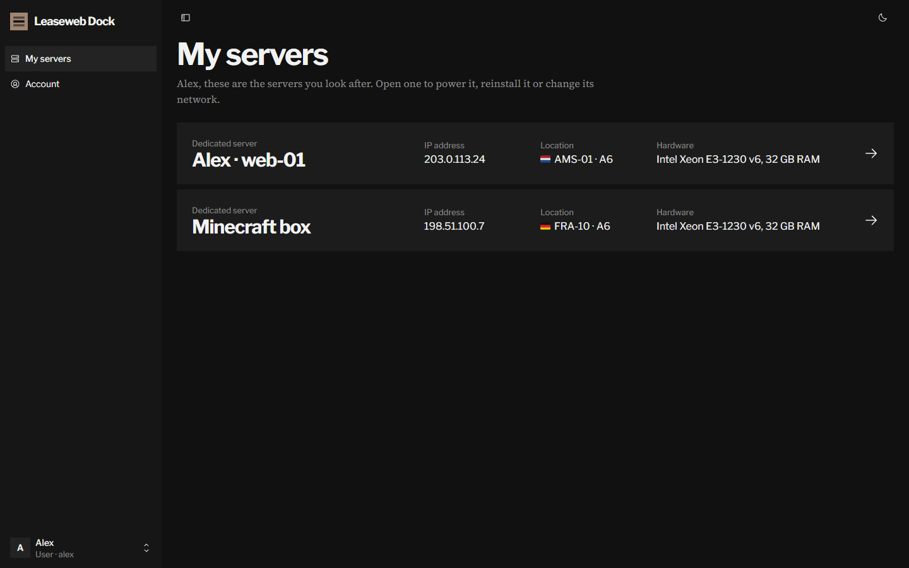 | 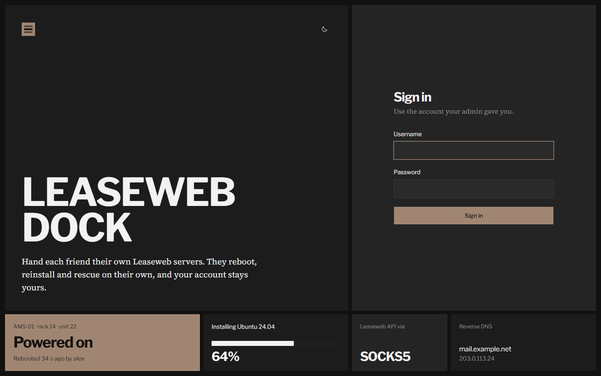 |
| **A user's servers** | **Sign in** |
| 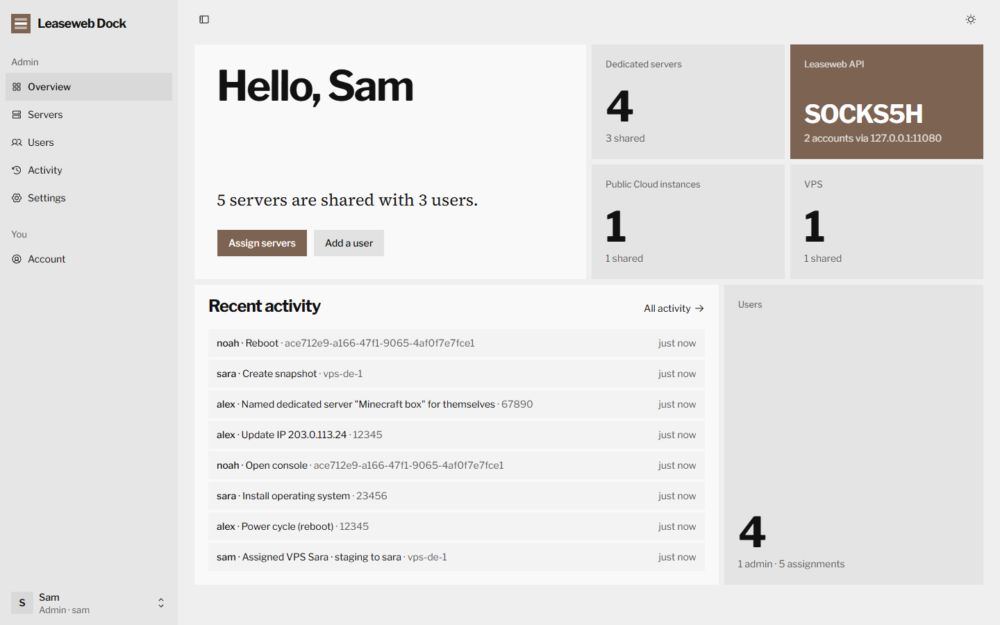 | 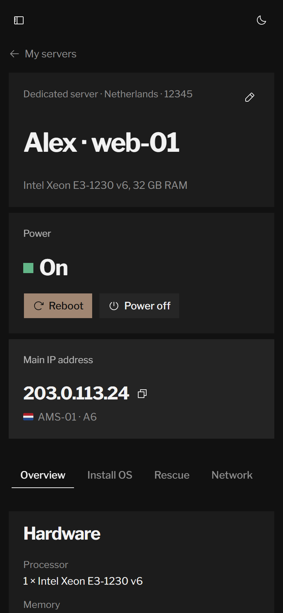 |
| **Light theme** | **On a phone** |

</details>

## Supported Leaseweb products

| Product | API | What users can do |
| --- | --- | --- |
| Dedicated servers | `bareMetals/v2` | Power, IPMI reset, OS install, rescue mode, jobs, IPs and reverse DNS, null routes, switch ports, credentials, bandwidth and traffic graphs, hardware report and scan |
| Public Cloud instances | `publicCloud/v1` | Start, stop, reboot, console, reinstall, snapshots, ISO, IPs and reverse DNS, null routes, credentials and password reset, CPU and traffic graphs |
| VPS | `publicCloud/v1/vps` | Same as Public Cloud, without the CPU graph |

Account-wide operations such as ordering, invoices, private networks and cancelling or terminating servers are deliberately left out.

## Outbound proxy

When the proxy is on, **every** request to the Leaseweb API, for every account, goes through it. If the proxy is down or rejects the login, requests fail with a clear error; the panel never falls back to a direct connection.

| Protocol | Use it for |
| --- | --- |
| SOCKS5, DNS resolved by the proxy (`socks5h`) | Most SOCKS5 proxies. No DNS query for `api.leaseweb.com` leaves your server. |
| SOCKS5 (`socks5`) | SOCKS5 proxies that need an IP address instead of a host name. |
| SOCKS4 | Old SOCKS4 proxies. |
| HTTP (`http`) | Ordinary HTTP proxies that support `CONNECT`. |
| HTTPS (`https`) | HTTP proxies you connect to over TLS. |

Username and password are optional, and the password is stored encrypted. **Test through proxy** checks the values on screen before you save them.

## HTTPS

Do not share the panel over plain HTTP. The simplest setup is [Caddy](https://caddyserver.com) on the same server: choose *127.0.0.1 only* in the installer, point a DNS name at the server, and use the port the installer printed:

```
# /etc/caddy/Caddyfile
dock.example.com {
    reverse_proxy 127.0.0.1:PORT
}
```

<details>
<summary><b>nginx instead of Caddy</b></summary>

```nginx
server {
    listen 443 ssl;
    server_name dock.example.com;
    # ssl_certificate and ssl_certificate_key from certbot or your CA

    location / {
        proxy_pass http://127.0.0.1:PORT;
        proxy_set_header Host $host;
        proxy_set_header X-Forwarded-For $proxy_add_x_forwarded_for;
        proxy_set_header X-Forwarded-Proto $scheme;
    }
}
```

</details>

To switch an existing installation to local-only, run the installer again and choose option 2.

## Configuration

| Variable | Default | Meaning |
| --- | --- | --- |
| `PORT` | `3000` | Port to listen on. With Docker Compose this is the host port, optionally with an address: `127.0.0.1:3000` listens on the local machine only. The installer writes it for you. |
| `APP_SECRET` | generated | Key that encrypts API keys and the proxy password. If empty, one is generated and stored next to the database. Never change it after setup, or the keys have to be entered again. |
| `DATA_DIR` | `./data` (`/data` in Docker) | Where the SQLite database lives. |
| `NPM_REGISTRY` | `https://registry.npmjs.org/` | Only for building the image yourself: the npm registry or mirror to download packages from. |
| `COOKIE_SECURE` | `auto` | `auto` marks the session cookie Secure when the request came over HTTPS. Set `true` behind a proxy that does not send `X-Forwarded-Proto`. |

## Back up and remove

```bash
# back up the database (keep /opt/leaseweb-dock/.env with it: it holds APP_SECRET)
docker run --rm -v leaseweb-dock_lwdock-data:/data -v "$PWD":/backup busybox tar czf /backup/lwdock-backup.tgz -C /data .

# remove everything, including data
cd /opt/leaseweb-dock && docker compose down -v && cd / && rm -rf /opt/leaseweb-dock
```

## FAQ

<details>
<summary><b>Is this an official Leaseweb product?</b></summary>

No. Leaseweb Dock is an independent open-source project that talks to the public [Leaseweb API](https://developer.leaseweb.com/). It is not affiliated with or supported by Leaseweb.

</details>

<details>
<summary><b>I buy from Leaseweb Netherlands and Leaseweb Germany. Do I need two panels?</b></summary>

No. Add one API key per Leaseweb company under *Settings → Leaseweb accounts*. Servers from all of them are listed together, each call uses the key of the account the server belongs to, and the flag shows where the server is.

</details>

<details>
<summary><b>Can my users see my prices or my other servers?</b></summary>

No. Each user only reaches the servers assigned to them, through a fixed list of allowed actions. Prices and customer IDs are removed from everything they receive.

</details>

<details>
<summary><b>I use server references to note who owns which server. Will users mess them up?</b></summary>

No. The panel never changes references at Leaseweb. Users can give a server their own name; it is stored in the panel and only they see it. You keep seeing your reference.

</details>

<details>
<summary><b>My server cannot reach api.leaseweb.com.</b></summary>

Turn on the outbound proxy under *Settings* and point it at a proxy that can. All Leaseweb traffic then goes through it.

</details>

<details>
<summary><b>Does it run on ARM servers?</b></summary>

Yes. The Docker image is published for `linux/amd64` and `linux/arm64`.

</details>

<details>
<summary><b>Where is my data stored?</b></summary>

In one SQLite database in a Docker volume (or `./data` when running from source). API keys and the proxy password are encrypted with your `APP_SECRET`.

</details>

## Security

- Users reach Leaseweb only through the panel, which checks every call against their assignments and a fixed list of allowed endpoints.
- Each server is reached with the API key of its own account; one account's key is never used for another account's servers.
- Passwords are hashed with scrypt. API keys and the proxy password are encrypted with AES-256-GCM.
- Sessions are HTTP-only cookies, sign-in attempts are rate limited, and cross-site requests are refused.
- Every change made through the panel is written to the activity log, without passwords or scripts.

Found a vulnerability? Please report it privately, see [SECURITY.md](SECURITY.md).

## Contributing

Issues and pull requests are welcome. [CONTRIBUTING.md](CONTRIBUTING.md) explains how to run the panel locally. The stack is Next.js 16, React 19, Tailwind CSS 4, [shadcn/ui](https://ui.shadcn.com) and SQLite (better-sqlite3). The visual design follows the [taste skill](https://www.tasteskill.dev) (`.claude/skills/design-taste-frontend`).

If Leaseweb Dock saves you a few late-night reboot messages, a ⭐ helps other people find it.

## Credits

Flags are drawn with [Twemoji](https://github.com/twitter/twemoji) (CC-BY 4.0) through the font from [country-flag-emoji-polyfill](https://github.com/talkjs/country-flag-emoji-polyfill), so they show on Windows too.

## License

[MIT](LICENSE). "Leaseweb" is a trademark of its owner and is used here only to describe what the software works with.
